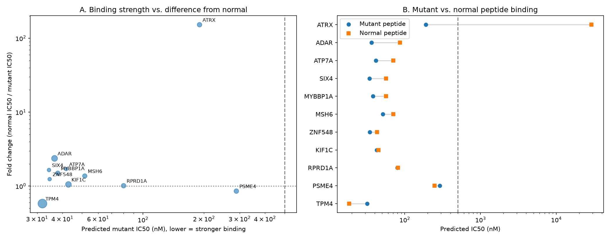
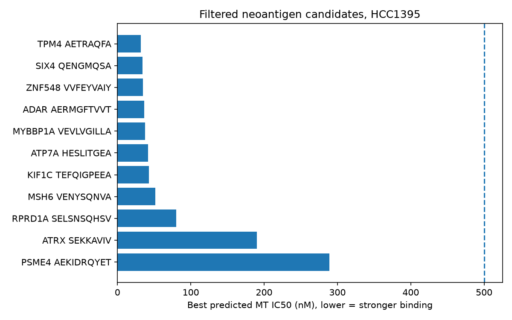

# Neoantigen prediction demo with pVACseq

A small, reproducible neoantigen prediction workflow run on public example data. It starts from somatic variants that were already called and annotated, so it does not include alignment or variant calling.

## Data
HCC1395 breast cancer cell line, tumour-normal example data distributed with pVACtools (`pvacseq download_example_data`).
- 1,470 somatic variants in the VCF (VEP-annotated, with expression data)
- 339 variant lines with a missense annotation

## Workflow
1. Run pVACtools in Docker (image `griffithlab/pvactools:latest`, pulled 16 November 2026; linux/amd64 emulation on Apple silicon).
2. Predict MHC class I binding for 8-, 9- and 10-mer peptides with MHCflurry and MHCnuggetsI.
3. HLA alleles: HLA-A*29:02 and HLA-B*45:01 (taken from the pVACtools example).
4. Summarise and plot candidates in Python (`summarize.py`, `plot_overview.py`).

```bash
docker run -it --platform linux/amd64 \
  -v $PWD/data:/pvacseq_example_data -v $PWD/output:/pvacseq_output_data \
  griffithlab/pvactools

pvacseq download_example_data /pvacseq_example_data
pvacseq run /pvacseq_example_data/pvacseq_example_data/annotated.expression.vcf.gz \
  HCC1395_TUMOR_DNA HLA-A*29:02,HLA-B*45:01 MHCflurry MHCnuggetsI \
  /pvacseq_output_data -e1 8,9,10 --normal-sample-name HCC1395_NORMAL_DNA
```

## Results
- 54,784 peptide-allele predictions scored across 358 mutations
- 11 candidates passed the default filters

| Gene | Mutation | HLA | Mutant IC50 (nM) | Normal IC50 (nM) | Fold change |
|------|----------|-----|------------------|------------------|-------------|
| ATRX | K/E | B*45:01 | 190 | 28,959 | 152 |
| ADAR | E/V | B*45:01 | 37 | 87 | 2.4 |
| ATP7A | D/H | B*45:01 | 42 | 71 | 1.7 |
| SIX4 | E/Q | B*45:01 | 34 | 57 | 1.7 |
| MYBBP1A | E/G | B*45:01 | 38 | 57 | 1.5 |
| MSH6 | D/N | B*45:01 | 52 | 71 | 1.4 |
| ZNF548 | D/Y | A*29:02 | 35 | 43 | 1.2 |
| KIF1C | S/F | B*45:01 | 43 | 45 | 1.1 |
| RPRD1A | Q/H | B*45:01 | 80 | 81 | 1.0 |
| PSME4 | H/D | B*45:01 | 289 | 247 | 0.9 |
| TPM4 | E/Q | B*45:01 | 32 | 18 | 0.6 |





**Interpretation:** all candidates are predicted binders (IC50 < 500 nM), but strong binding alone is not enough, because the immune system is probably tolerant to peptides the normal protein also presents. ATRX (K/E) stands out: the mutant peptide binds well while the normal peptide is predicted not to bind, and the variant has a tumour VAF of about 1.0 in DNA and 0.99 in RNA, with the gene expressed. TPM4, KIF1C, RPRD1A and PSME4 bind no better than their normal peptides, so they are weaker candidates.

## Limitations
- Example data, starting from pre-called variants: no alignment or variant calling here.
- Only two HLA alleles and two prediction methods; a real pipeline would use the patient's HLA typing and more predictors.
- Cell line data (breast cancer), not pancreatic cancer.
- Predictions only; candidates would need experimental validation.

## Files
`summarize.py`, `plot_overview.py`, `output/top_candidates.csv`, `output/neoantigen_overview.png`, `output/candidates_ic50.png`, `output/run.log`
